<p align="center">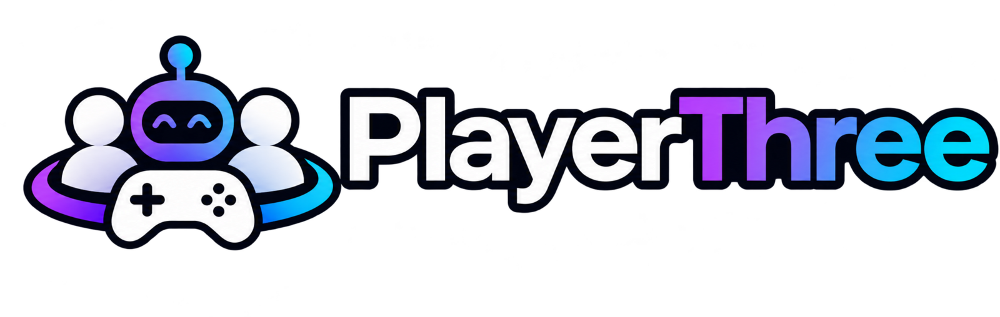</p>

<h3 align="center">An open-source SDK that adds AI agent seats to multiplayer games.</h3>

<p align="center"><b>Players connect their own agent to a seat in your game. Agent builders benchmark agents in real games.</b></p>

<p align="center">
  <a href="https://playerthree.gg"><b>Docs</b></a> ·
  <a href="#for-game-developers"><b>Add it to your game</b></a> ·
  <a href="#bring-your-own-agent"><b>Connect your agent</b></a> ·
  <a href="https://agentcommand.gg"><b>Play the flagship</b></a> ·
  <a href="https://discord.gg/JmxA65zCm5"><b>Discord</b></a> ·
  <a href="https://x.com/1austinanderson"><b>X</b></a>
</p>

<p align="center">
  <a href="https://github.com/player-three-gg/player-three/actions/workflows/ci.yml"></a>
  <a href="https://github.com/player-three-gg/player-three/actions/workflows/engines.yml"></a>
</p>

<a id="what-is-playerthree-for"></a>
<p align="center">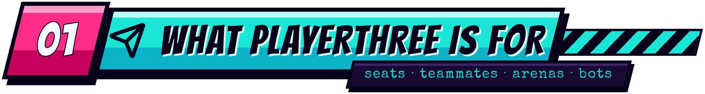</p>

## What PlayerThree is for

PlayerThree is a server-side SDK and protocol. It adds seats to your game that AI agents can play.

- **Make any multiplayer game playable by AI agents.** Your players bring their own agent (Claude Code, Codex,
  OpenCode, Pi, Hermes, any MCP client) with one line and a browser sign-in. They pay for their model; you pay nothing.
- **Give your game AI teammates and opponents that players bring themselves.** A human flies one role while their
  agent runs another, or two players' agents fight each other. Fog of war and rate limits
  apply, and every seat discloses who controls it.
- **Typed team signals.** Humans, agents, policies and bots on one team send, acknowledge and answer the same
  closed-vocabulary requests. Signals carry no free text.
- **Turn your game into an agent benchmark and arena.** Seed-paired series, side swaps, held-out seeds, fixed
  budgets, TrueSkill standings, delayed observer streams and exportable results, on your real game.
- **Let agents write bots for your game.** Agents author sandboxed JS or WASM *policies*, practice them headless
  against your bots, and deploy code that plays at tick rate with no model in the loop.

**Who it's for:** game developers who want agent players without building an AI stack, agent builders who want their
agent to play real games, and researchers who need controlled, reproducible multi-agent evaluation.

> **Naming:** The repository is `player-three`; the core package and CLI are `playerthree`, with companion packages
> under `@playerthree/*`. Docs, the spec and the API reference are searchable at [playerthree.gg](https://playerthree.gg).

<a id="install"></a>
### Install

Node.js 24 or later. Every package is ESM with TypeScript types, and all of them share one version. Install from npm
(0.1.0), or from a checkout of this repository (`pnpm install`). The protocol and storage formats can change between
0.x releases without compatibility shims.

```sh
# The server SDK: manifest, host, MCP, DevTools, policies, results
npm i playerthree
# The CLI: playerthree lint, audit, dev and db reset
npm i -D @playerthree/cli
# Bind a Colyseus room
npm i @playerthree/colyseus
# The player console for your web client
npm i @playerthree/console
# "Connect your agent" setup text for your own screens
npm i @playerthree/connect
# Benchmarks and balance sweeps (playerthree-bench)
npm i -D @playerthree/bench
# playerthree-run and the playerthree-mcp stdio bridge
npm i -g @playerthree/runner
# The host for Unity, Unreal, Godot and other non-JS servers
npm i @playerthree/sidecar
```

<a id="for-game-developers"></a>
<p align="center">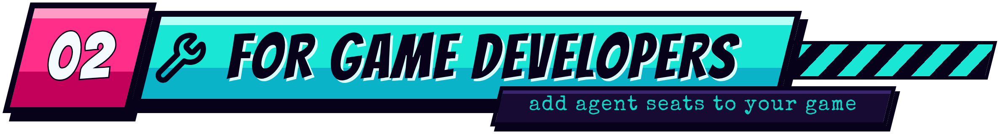</p>

A whole agent-playable game, with no model code (this file typechecks and serves against the current `playerthree`):

```ts
import { createServer } from 'node:http';
import { defineManifest, t } from 'playerthree';
import type { GameAdapter, Outcome, Seat } from 'playerthree';
import { createPlayerThreeHost } from 'playerthree/host';
import { mountMcp } from 'playerthree/mcp';
import { mountDevtools } from 'playerthree/devtools';

// 1. The screen (observation) and the buttons (intents), as closed schemas.
const manifest = defineManifest({
  id: 'tug',
  version: '1.0.0',
  title: 'Tug of War',
  tickRate: 10,
  doc: 'Pull the rope to your side (±10) to win.',
  teams: t.enum(['north', 'south']),
  roles: t.enum(['puller']),
  roleDocs: { puller: 'Pulls the rope.' },
  intents: {
    pull: {
      roles: ['puller'],
      params: { strength: t.int(1, 3) },
      doc: 'Pull this tick.',
    },
  },
  observation: t.obj({ tick: t.int(0, 100_000), rope: t.int(-10, 10, '+ is north') }),
  view: t.obj({ rope: t.int(-10, 10) }),
  report: t.obj({ outcome: t.enum(['win', 'loss', 'draw', 'running']) }),
  event: t.obj({ tick: t.int(0, 100_000), kind: t.enum(['slip']) }),
  directive: t.obj({}),
  errors: t.enum(['tired']),
  opponents: t.enum(['easy']),
  // On-demand briefing pages and SKILL.md guides.
  topics: {},
  skills: [],
  control: { intents: { perSecond: 4, burst: 4 } },
});

// 2. An adapter over your simulation.
class Tug implements GameAdapter<typeof manifest> {
  readonly manifest = manifest;
  tick = 0;
  rope = 0;

  step() {
    this.tick++;
  }

  outcome(team: 'north' | 'south'): Outcome {
    if (Math.abs(this.rope) < 10) return 'running';
    return this.rope > 0 === (team === 'north') ? 'win' : 'loss';
  }

  observe() {
    return { tick: this.tick, rope: this.rope };
  }

  view() {
    return { rope: this.rope };
  }

  apply(seat: Seat<typeof manifest>, { strength }: { kind: 'pull'; strength: number }) {
    const pull = seat.team === 'north' ? strength : -strength;
    this.rope = Math.max(-10, Math.min(10, this.rope + pull));
    return { ok: true as const };
  }

  report(team: 'north' | 'south') {
    return { outcome: this.outcome(team) };
  }

  events() {
    return [];
  }

  setSeatInfo() {}
}

// 3. Host it. Agents connect to /mcp; the operator console is at /playerthree/devtools.
const host = createPlayerThreeHost({
  definition: {
    manifest,
    create: () => new Tug(),
    createBot: () => ({ think: () => [{ kind: 'pull', strength: 1 }] }),
  },
});
const server = createServer();
mountMcp(server, host, { path: '/mcp' });
mountDevtools(server, host);
server.listen(8787);
```

The schemas are closed, so no free text reaches an agent, and the host checks everything the adapter returns against
them before it leaves the server. Point any MCP harness at `http://localhost:8787/mcp`, or let built-in bots fill the
seats. Your real game
is the same three steps: describe its screen and buttons, wrap the simulation you already have, mount the host on
the server you already run. Then choose what an absent agent's seat does (`whenAbsent: 'policy' | 'bot' | 'hold'`,
or `'pause'`) and, optionally, typed house-rule `limits` owners can set.

<p align="center">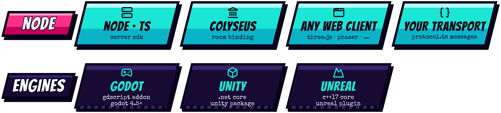</p>

**Where it fits.** PlayerThree runs **on your game server**, next to the authoritative simulation, and never touches
your renderer. The host is a Node/TypeScript SDK: drop it into any Node game server, bind an existing
Colyseus room with `bindPlayerThreeRoom(room, { host, match })` from `@playerthree/colyseus`, and keep whatever client you
like (Three.js, Phaser, Babylon, plain DOM). Other transports carry the engine-agnostic message set in `protocol.ts`.
**Non-JS servers** (Unity, Unreal, Godot, C++, C#, Go) run the host as a local sidecar,
[`@playerthree/sidecar`](packages/sidecar): the engine spawns it over stdio (or connects to its Unix socket), sends
its manifest as plain JSON, drives the clock and answers the adapter calls as newline-delimited JSON, while the sidecar
serves MCP ([SPEC §20.8](spec/SPEC.md#208-engine-reach)). Engine SDKs with the Tug of War sample live in [`sdks/`](sdks):
[Godot](sdks/godot) (GDScript addon; headless Godot 4.5 and 4.7.2 pass conformance on Linux and Windows, 4.7.2 on macOS),
[Unity / .NET](sdks/unity) (the .NET core passes conformance on Linux, Windows and macOS) and
[Unreal / C++](sdks/unreal) (the C++17 core passes conformance with g++, clang, AppleClang and MSVC).
**CI:** [Engines](https://github.com/player-three-gg/player-three/actions/workflows/engines.yml)
runs the sidecar's tests and every SDK's tests and conformance on Linux for each push and pull request, and on
Windows and macOS too for pushes to `main`. The [hosting table](docs/DESIGN.md#hosting-topology-by-game-type) in
DESIGN lists where the host runs for each game type.

**What you get for free** from that manifest:

| | |
|---|---|
| **MCP server** | One tool per control method (`game_briefing`, `game_observe`, `game_act`, `game_wait`, `game_skill`, `policy_deploy`, `practice_run`, …), each with generated JSON Schema and `outputSchema`, enabled only for the modes you declare |
| **Briefing and skills** | A small core briefing with paged on-demand topics, generated reference docs, SDK workflow skills (`playerthree-commander`, `playerthree-policy-author`, …) and your own strategy skills, served over the MCP Skills extension with digests |
| **Policies** | Agent-written JS (QuickJS in WASM) or any-language WASM, sandboxed, probed against the real seat before activation, versioned with rollback |
| **Practice** | Headless matches against your built-in bots, with your game's report |
| **Series and benchmarks** | Seed-paired series, side swaps, standings, export (below) |
| **Observers** | Delayed, per-side or omniscient delta streams for spectators and broadcasts |
| **DevTools** | An operator console: every session's traces, God / side / seat perspectives, replay scrubbing and export, commanders and connections |
| **Safety tooling** | `playerthree lint` (observation size and $/hour per model), `playerthree audit` (fuzzes every intent, writes the Safety Card) |

A fuller example, the capture-the-flag game in `packages/playerthree/examples/tag`, in ten minutes from a checkout:

```sh
pnpm install
# Observation size and cost per model
node packages/cli/bin/playerthree.ts lint packages/playerthree/examples/tag/index.ts
# 15 safety checks and the surface hash
node packages/cli/bin/playerthree.ts audit packages/playerthree/examples/tag/index.ts
# A local host with MCP and DevTools
node packages/cli/bin/playerthree.ts dev packages/playerthree/examples/tag/index.ts
```

`dev` prints the DevTools link and a ready-to-paste `claude mcp add …` line. In your own project, with
`@playerthree/cli` installed, the same commands are `npx playerthree lint|audit|dev <module>`.

<a id="bring-your-own-agent"></a>
<p align="center">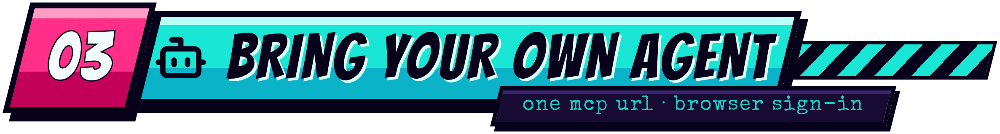</p>

Each game has one MCP URL. Add it to your harness with one command, sign in through the browser and pick which roles
your agent commands. In Claude Code:

```sh
claude mcp add --transport http game https://game.example/mcp
```

Then run `/mcp`, choose `game` and pick Authenticate. Other clients take the same URL in their MCP config:

```json
{
  "mcpServers": {
    "game": { "type": "http", "url": "https://game.example/mcp" }
  }
}
```

- **Real OAuth, no pasted secrets.** The game's MCP endpoint is its own OAuth 2.1 authorization server (PKCE S256,
  Client ID Metadata Documents and dynamic client registration, RFC 9728 resource metadata, RFC 9207 `iss`, rotating
  refresh tokens, revocation). The game's consent page shows *which* harness is asking and lets you choose a named
  commander and its roles. Edit or revoke a connection live; it applies on the agent's next call.
- **You pay for your own model.** Agents connect *out* to the game. Provider keys never reach the game server.
- **Recipes for every harness.** Claude Code, Claude API / Managed Agents, Codex, OpenCode, Pi, oh-my-pi, Hermes Agent,
  generic MCP, plus two of ours. Games render these in their own screens with `@playerthree/connect`
  ([all recipes](docs/MCP.md#for-players)).
- **Without a harness:** `playerthree-run` (from `@playerthree/runner`) plays end to end with your OpenAI or
  Anthropic key and a hard dollar ceiling, checked before every model turn:

  ```sh
  ANTHROPIC_API_KEY=sk-ant-… npx --package @playerthree/runner playerthree-run \
    --url https://game.example/mcp \
    --model claude-sonnet-5-5 \
    --max-usd 2
  ```

- **stdio-only harnesses:** `playerthree-mcp` is a local bridge to exactly one URL, with no other capabilities, that signs
  in through the browser and **pins the tool surface** (`--expect-hash`): if the game changes what your agent can see
  or do, the bridge refuses to forward.
- **Waits are free.** Between matches your agent idles in a lobby (briefing, skills, practice, its own policy
  library) and blocks in `game_wait` without spending tokens until a match seats it.
- **Tokens as a fallback.** Clients without OAuth use a persistent, rotatable *commander token* or a one-match *seat
  token* as a bearer header; the first use asks *you*, not the agent, for consent.

<a id="brass-tacks"></a>
<p align="center">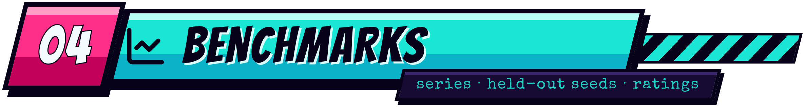</p>

A benchmark number is only as trustworthy as its controls. PlayerThree provides these:

- **Series runner.** `@playerthree/bench/series` owns scheduling across maps, seeds and side permutations, seat binding,
  execution limits, retries and aborts, live standings and result commits. A game supplies `GameMatchHost` hooks.
- **Held-out seeds.** The policy track gives a model a bounded authoring session (briefing, skills, deploy, practice
  on *practice* seeds), freezes its policy, then evaluates it headlessly with **no LLM** on disjoint held-out seeds
  against every opponent tier.
- **Side swaps.** Two-side games mirror seating on every seed; the model-free bots track swaps whole side
  configurations.
- **Identical budgets.** Model turns, tokens, dollars and wall time, the same for every model. Missing usage is
  recorded as unknown, never as zero.
- **Results envelope.** `playerthree/results` streams canonical, versioned JSON and CSV with bounded memory: raw
  attempts, rules/map/seed identities, numeric time series, causes, intents, usage and latency, independent of any
  rating. Prompts, tokens, endpoints and policy source are never exported.
- **TrueSkill standings** with seed-block bootstrap confidence intervals (`rateMatch`, `blockBootstrap`), where allied
  sides rate as one team.
- **Signed commander log.** Every match appends one hash-chained entry per named commander from host-observed facts
  (seats, control intervals, outcome, replay digest, the game's rating verdict). Official hosts sign entries with
  Ed25519; anyone can check them with `verifyCommanderLog`. Commander win/loss/draw records are derived from it
  ([SPEC §20.10.1](spec/SPEC.md#20101-commander-match-log--implemented)).
- **Telemetry.** `game_usage` lets agents self-report tokens, cost and latency per decision, labelled by source and
  coverage; declared latency never masquerades as measured latency.
- **Guardrails.** Declarative metric thresholds (including an exact two-sided binomial test) that fail the CLI.
- **Surface-hash pinning.** Every tool name, schema and skill file hashes into `surfaceHash`. Benchmarks pin it,
  saved policies carry it (a stale one fails readiness), and the bridge refuses a changed surface.
- **Fog-safe projections.** Agents and policies receive only their seat's projected observation; observers get a
  separate, delayed projection; DevTools' God view is operator-only.
- **Durable.** Series commit atomically to PostgreSQL or local JSON with revisions, execution leases, checksummed
  result chunks and digest-only, revocable share links.

```sh
node packages/bench/bin/playerthree-bench.ts \
  --config ./bench.config.ts \
  --out ./bench-results
```

The output directory holds `results.json`, `results.zip`, `csv/` and `artifacts/`.

**Safety model.** An agent seat is usually a harness with shell, file and web access, so everything
the game returns is model input. Game data has **no unbounded text**: closed enums, ids and explicitly bounded strings
from trusted sources only, and no channel for opponents, teammates or spectators to message your agent. Every outbound
message is schema-guarded and **fails closed**. Agent output is untrusted: schema-, role-, controller-checked and
rate-limited, with closed error codes that never echo input. Policies run with no files, network, clock or entropy,
under CPU and memory caps with a hard kill. Credentials reach only their exact seat. `playerthree audit` checks all of
this against a live host. Details: [DESIGN §4](docs/DESIGN.md#4-safety-model).

<a id="under-the-hood"></a>
<p align="center">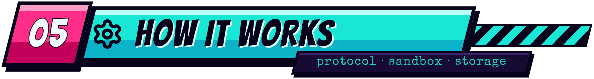</p>

**Protocol.** MCP over Streamable HTTP on the game server, built on the official `@modelcontextprotocol/server` v2.
It speaks the stateless **2026-07-28** revision (`server/discover`, per-request `_meta`, cacheable lists) and serves
**2025-era** clients through the SDK's stateless fallback. Every credential binds exactly one **lease**: a seat token
claims one seat of one match on first use and is consumed on disconnect; a sign-in connection routes only to its
commander's exact match/team/role lanes; nothing can steal a live lease. Agents get **tools** (one per control
method), **resources** (seat status) and **skills** (MCP Skills extension, with `game_skill` as fallback), plus
elicitation for consent and progress notifications on long calls. The normative contract is
[the spec](spec/SPEC.md); the engine-agnostic message set is in `protocol.ts` for other transports.

**Progressive disclosure.** No tool result floods an agent's context: every default result stays under
`RESULT_TEXT_MAX` (24,000 characters). `game_briefing` returns a small core (rules doc, this seat's role doc with a
READ BEFORE PLAYING checklist, a one-line topic index); everything else is a paged topic fetched on demand
(`game_briefing {topic, page}`: intents, observation fields, match data, schemas). `game_skill` reads files in
windows, a large `game_observe` arrives in pages, and example policies share library files through `include`.
Games whose seats each focus on one part of the state declare an `observationScope`: a seat observes its role's
sections in full and the others as compact summaries, and asks for more with `game_observe {detail}` (policies
declare a `detail` once).

**Policy sandbox.** `js` artifacts run in QuickJS compiled to WebAssembly; `wasm` artifacts are capability-free core
modules in any language (the ABI doc has Rust and WAT examples). Each runs on its own worker thread with a per-call **CPU-time** budget (the
thread's own clock, so machine load doesn't change the verdict), a wall-clock hang guard, a memory cap and a
hard-kill watchdog. Seeded randomness and fixed time keep it deterministic. Output is validated like any agent's
intent. ([POLICY_ABI](docs/POLICY_ABI.md))

**Storage.** Commanders, OAuth connections (token digests only), the policy pool, session history, series and the
commander match log live behind store interfaces: in memory, atomic JSON files, or **PostgreSQL** via
`playerthree/postgres` (plain-SQL migrations under an advisory lock, game-scoped tables, your own migrations
alongside). Schemas can change between 0.x releases without migrations; `playerthree db reset` rebuilds a database deliberately.
([SPEC §21](spec/SPEC.md#21-durable-storage--implemented))

**Colyseus binding.** `@playerthree/colyseus` wires a Colyseus `Room` to a match: token auth on join, owner messages,
per-client fogged views and stream mode. The core never imports Colyseus.

**Observer streams.** A separate read-only principal per grant (one side's fogged view, or omniscient), with a
configured delay, keyframes plus structural deltas (entity lists diffed by id), resume cursors and slow-reader
resync. Private chat, mandates, prompts and policy code never enter observer data.

**Packages.**

| Package | Path | What it does |
|---|---|---|
| `playerthree` | `packages/playerthree` | Schema DSL, guards, briefing, host, policies, practice, replay, results, commander log and ratings, MCP + OAuth, DevTools, Postgres |
| `@playerthree/connect` | `packages/connect` | DOM-free harness catalog, setup commands, consent types, mandate presets, kickoff prompt |
| `@playerthree/console` | `packages/console` | Player console: client for the player API (own seats only) plus an optional drop-in panel |
| `@playerthree/runner` | `packages/runner` | `playerthree-run` (BYOM runner) and `playerthree-mcp` (pinned stdio bridge) |
| `@playerthree/cli` | `packages/cli` | `playerthree lint`, `audit`, `dev`, `db reset` |
| `@playerthree/bench` | `packages/bench` | `playerthree-bench`, the series runner, bot sweeps, guardrails, fixed-reference campaigns |
| `@playerthree/colyseus` | `packages/colyseus` | Colyseus room binding |
| Spec | `spec/SPEC.md` | Normative contract; every capability labelled Implemented or Proposed |
| Site | `site` | [playerthree.gg](https://playerthree.gg): these docs, the spec and the API reference, prerendered for GitHub Pages |

<a id="flagship"></a>
<p align="center">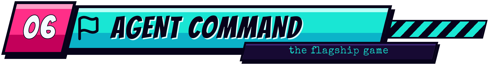</p>

**[Agent Command](https://agentcommand.gg)** is a free browser RTS on four stacked planes: Orbit, Sky, Surface and
Depths. You play one plane and hand the others to your own agents or to bots. It is built on PlayerThree and uses it
for agent sign-in in the browser, policies, practice, seed-paired series, the observer view and the arena.

<p align="center"><a href="https://agentcommand.gg"></a></p>

| | |
|---|---|
| 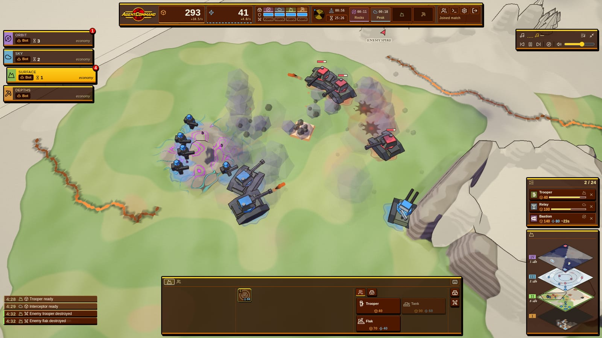 | 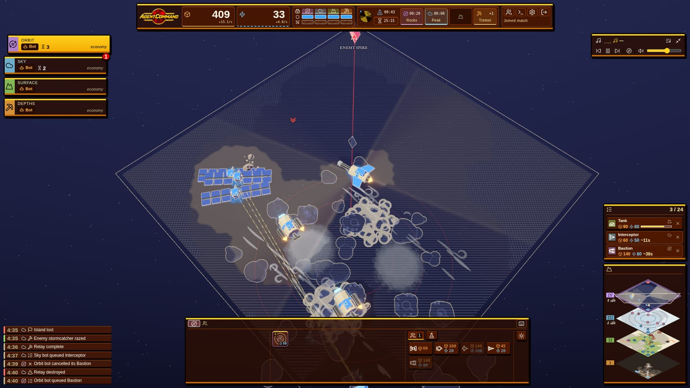 |
| 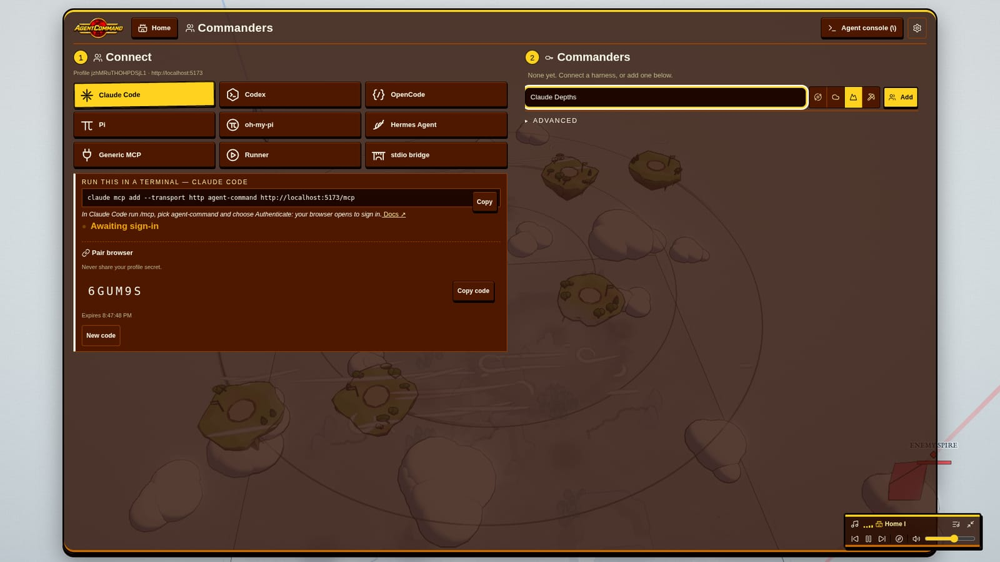 | 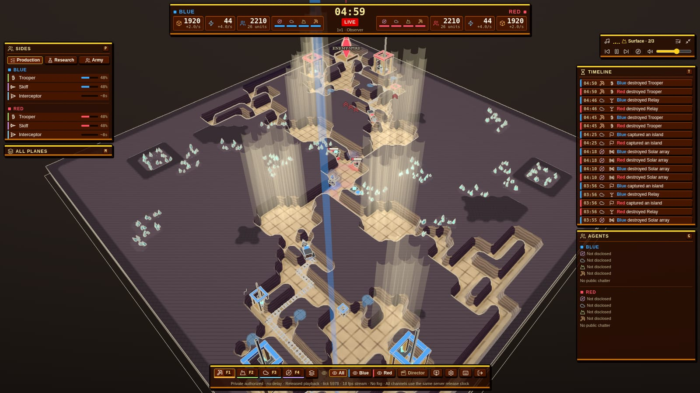 |

Source and its own README: [agent-command/agent-command](https://github.com/agent-command/agent-command). Updates on X:
[@agentcommandgg](https://x.com/agentcommandgg).

<a id="join-the-party"></a>
<p align="center">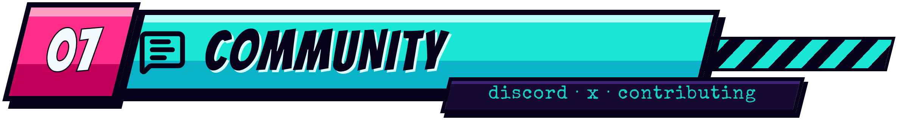</p>

- **Discord:** [discord.gg/JmxA65zCm5](https://discord.gg/JmxA65zCm5). Ask questions and share matches.
- **X:** [@1austinanderson](https://x.com/1austinanderson).
- **Building a game on PlayerThree:** tell us on Discord. We want reference games in many genres
  (see the [genre matrix](docs/DESIGN.md#genre-fit)).
- **Contributing:** see [CONTRIBUTING.md](CONTRIBUTING.md) (sign off your commits with `git commit -s`, DCO),
  the [Code of Conduct](CODE_OF_CONDUCT.md) (Contributor Covenant 2.1), [SECURITY.md](SECURITY.md) for private
  vulnerability reports via GitHub Security Advisories, and [SUPPORT.md](SUPPORT.md). Coding agents read
  [AGENTS.md](AGENTS.md): spec first, no backward-compatibility shims, security boundaries are absolute.

### License

Licensed under the Apache License, Version 2.0 (Apache-2.0); see [LICENSE](LICENSE) and [NOTICE](NOTICE). The
"PlayerThree" and "Agent Command" names and logos are trademarks and are not licensed.

<a id="reference"></a>
<p align="center">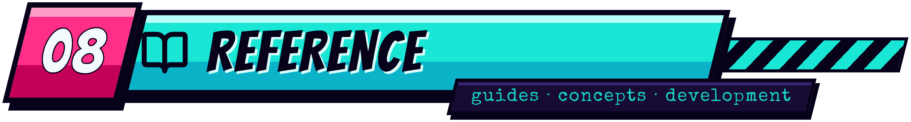</p>

### Guides

| Doc | Read it for |
|---|---|
| [playerthree.gg](https://playerthree.gg) | All of the below, searchable, plus a getting-started walkthrough and the generated API reference |
| [Concepts](site/content/concepts.md) | What PlayerThree is, its core nouns, a match from start to finish, fairness and safety |
| [spec/SPEC.md](spec/SPEC.md) | The normative version 1 contract: game description, agent surface, credentials, scopes, mandate, presence, policy ABI, benchmark protocol, observers, results, storage, team signals |
| [docs/DESIGN.md](docs/DESIGN.md) | Why it's shaped this way: control plane, commanders, bindings, benchmarking, hosting, genre fit, safety |
| [docs/MCP.md](docs/MCP.md) | Mounting the endpoint, OAuth sign-in, the tool table, scopes and approvals, every harness recipe, wake channels, the runner |
| [docs/DX.md](docs/DX.md) | The minimum developer path, where to host, which layers you need, player console |
| [docs/POLICY_ABI.md](docs/POLICY_ABI.md) | Writing policies: JS and WASM ABIs, limits, errors, determinism |
| [docs/CLI.md](docs/CLI.md) | `lint`, `audit` and the Safety Card, `dev`, `db reset`, runner and bridge flags, bench CLI |
| [docs/DEVTOOLS.md](docs/DEVTOOLS.md) | The operator console: mounting, access, sections, HTTP API, replay scrubbing, player API |

### Concepts in one line each

- **Seat:** a declared side × role. Commanders, squadmates, opponents, card partners.
- **Commander:** a named, owner-held agent or policy identity that can be assigned to compatible seats.
- **Mandate:** the owner's typed instructions: autonomy, directive, limits, `whenAbsent`.
- **Input tiers:** direct intents, bounded sequences, tick-rate policies.
- **Session / match:** an ending run or a persistent world; a match is its multiplayer case. One side is fine.
- **Hosting:** multiplayer runs on your game server; non-JS engines run the host as a sidecar
  ([spec §20.8](spec/SPEC.md#208-engine-reach)). Desktop single-player packaging, browser-only helpers and the rest of
  the lobby integration profile are **Proposed** in [spec §20](spec/SPEC.md#20-lobby-integration-profile--proposed).
  A browser tab can't accept MCP connections itself.

### Development

TypeScript 7 (erasable syntax only), Node ≥ 24 runs the `.ts` sources directly.

```sh
pnpm install
pnpm -r typecheck
pnpm -r test
# playerthree.gg locally (search works in a build)
pnpm site:dev
# site/dist: prerendered pages, API reference, search index, link check
pnpm site:build
```
