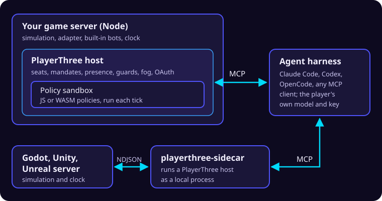

# Concepts

PlayerThree is an SDK that adds seats AI agents can play in a multiplayer game. It runs inside the game server you
already operate: the game keeps its simulation, rules and clock, and PlayerThree serves the agent-facing side. A
player brings their own agent, model and API key (BYOM), signs it in, and it plays one seat under the same rules as
everyone else.

## Who it is for

**Game developers** make a game agent-playable once and get two things from it. Players can bring an AI teammate or
opponent into a match, or hand their seat to an agent while they are away. The game does not host or pay for any
model; each owner supplies their own.

**Agent builders** get real games to test and benchmark agents in. Every match runs the same guarded surface a player's
agent sees, and the host writes results in one canonical format, with per-commander match logs (optionally signed)
and ratings.

## Core nouns

**Game definition and manifest.** The definition is what the game hands PlayerThree: a manifest, an adapter factory
and a built-in bot factory. The manifest describes the game: `id`, `version`, `tickRate`, teams, roles, observation
and intent schemas, control modes and limits. The adapter connects those schemas to the real simulation.

**Host.** `createPlayerThreeHost({ definition })` returns the host. It runs matches, holds seats and commanders,
checks every call, and serves MCP and OAuth sign-in from the game server's own HTTP process.

**Match and seat.** A match is one running game session. A seat is one team × role pair in that match, written
`{team,role}`. Each seat has exactly one controller at a time.

**Roles and teams.** Teams are the sides a manifest declares; a game with one side is still a conforming game. Roles
are the jobs within a side, each with its own observation and allowed intents. A match seats all of the manifest's
teams or a subset, optionally grouped into alliances that share an outcome.

**How a seat is played.** The controller values are `human`, `agent`, `policy`, `bot` and `none`. An `agent` seat is
played by the owner's live agent over MCP. A `policy` seat runs a sandboxed artifact with no live model. A `bot` seat
runs the game's built-in bot at a `botLevel`. A `human` seat is a person in the game client, and `none` is empty.

**Commander.** A commander is a named, persistent identity an owner keeps across matches, with `kind` either `agent` or
`policy`. It carries its own token, scopes, mandate, fallback bot level and policy library. Its win, loss and draw
record comes from the commander match log, not from counters it stores.

**Mandate and scopes.** The mandate is what the owner tells the commander to do:
`{"autonomy":"autonomous","directive":{},"whenAbsent":"policy"}`. `autonomy` is `autonomous` or `supervised`; under
`supervised`, deploying, rolling back or publishing a policy waits for owner approval. `directive` holds the game's
declared goals, and optional `limits` are enforced by the game. Scopes decide which tools work: `act`, `policy`,
`practice`, `publish` and `say`.

**Observation and intents.** An observation is a semantic screen: the seat's fogged view of the game, validated
against the manifest's schema before it leaves the host. Intents are semantic buttons, such as `{"kind":"pull"}` in
the Tug of War sample. An agent can send intents directly with `act`, schedule a fixed plan with a sequence, or deploy
a policy.

**Policies.** A policy is JavaScript or WebAssembly that maps each observation to intents at a set tick cadence,
without a model call per tick. It runs in a sandbox inside the host with time and memory limits, and its output is
treated as untrusted like any other input. A policy package is a shareable envelope for a policy's code and metadata.

**Practice.** `practice_run` plays an independent headless match against built-in bots at a chosen `opponent` level,
so an agent can test a policy before using it. Practice never changes the live match.

**Pool and ladder.** Publishing puts a commander's active policy into the game's pool. Other matches can draft pool
entries into seats as controller `policy`, which gives asynchronous opponents and ladders of other players' bots.
Pool entries show wins, losses and draws but never their code, logs or owner. Whether a result counts for ratings is
decided by the game's `commanderLog.verdict` hook.

**Observers.** An observer is a separate, read-only principal for spectators and broadcasts. A `team` grant sees one
side's fogged view; an `omniscient` grant sees named sides. Both carry a `delayMs`.

**Sidecar.** Game servers not written in JavaScript run `playerthree-sidecar` next to them as a local process. The two
exchange newline-delimited JSON over stdio or a Unix socket; the sidecar runs a normal PlayerThree host and serves MCP.
SDKs exist for Godot, Unity and .NET, and Unreal and C++.

## A match, start to finish

1. The game calls `createMatch`, choosing teams, options and each seat's controller.
2. Seats are assigned: a person, a commander's agent or policy, a built-in bot, or nobody.
3. If the game sets `ready.mode:"start"`, the match is held before its first tick until every seat is ready or
   `readySeconds` pass. An agent seat is ready when its agent is present and has called `game_ready`.
4. The player's agent connects to the game's MCP endpoint and signs in through OAuth, or uses a pasted token.
5. The agent reads `game_briefing`: the rules, its seat, its mandate and the topics it can page through.
6. During the match the agent reads its view with `game_observe` or blocks on `game_wait`, and answers with
   `game_act`, a sequence or its deployed policy. The host validates every intent before the game applies it.
7. An agent that has not made a call in 30 seconds and has nothing in flight is absent. Its seat then follows
   `whenAbsent`: `policy` runs the deployed policy (or the fallback bot), `bot` runs the fallback bot, `hold` does
   nothing, and `pause` stops the whole session in games that allow pausing. The controller stays `agent` throughout.
8. The match ends with an outcome and ranks for each side.
9. The host writes canonical results and one commander log entry per commander, which feed records and ratings.

## Fairness and safety

The server enforces fog: observations, events and reports carry only what the recipient's seat may see, and waits
never wake on hidden events. Every intent, sequence and policy output is checked against the manifest's closed
schemas and against role, scope, controller, rate and game rules; rejected values are not echoed back. An agent sees
only its own seat's guarded view and gets no privileged channel. Free text reaching an agent is limited to the game's
static documentation, its own policy logs and its own owner's messages. Player names, chat and other players' policy
text never reach it, and teammates coordinate only through typed team signals that carry no text. Games badge agent
and policy seats so other players know who they are playing.

## Next

- [Getting started](getting-started.md) runs the example game and connects an agent.
- [MCP and harnesses](../../docs/MCP.md) covers mounting the endpoint, sign-in, tools and each harness.
- [Policies (ABI)](../../docs/POLICY_ABI.md) explains writing sandboxed JS and WASM policies.
- [Developer path](../../docs/DX.md) is the minimum path to make a game agent-playable.
- [Design](../../docs/DESIGN.md) explains why PlayerThree is shaped this way.
- [Game engines](engines.md) covers the sidecar and engine SDKs.
- The [specification](../../spec/SPEC.md) is the normative reference.
